<a href="https://prathameshtikle.tech"></a>

I am a Computer Engineering student in Pune, taking Honours in Cybersecurity and graduating in 2027. I work on offensive security and security engineering, and most of what I build checks whether something is what it claims to be: a VPN tunnel, an attacker session, a salary slip.

I have been president of my college's Cybersecurity Club since August 2024, and since July 2026 I have mentored web-vulnerability bootcamps at DevTown. Right now I am working on MALINT-X, a triage pipeline for fraudulent banking APKs.

 


<a href="https://prathameshtikle.tech/capture"></a>

 

<a href="https://github.com/Prathamesh0-0/IPsec_Sentinel"></a>
<a href="https://github.com/Prathamesh0-0/VeriFlow-Suraksha"></a>
<a href="https://github.com/Prathamesh0-0/panoptes"></a>
<a href="https://github.com/Prathamesh0-0/nexacore-engine"></a>
<a href="https://github.com/Prathamesh0-0/KSP-CrimeIntel"></a>
<a href="https://prathameshtikle.tech/work/malint-x"></a>

 



 


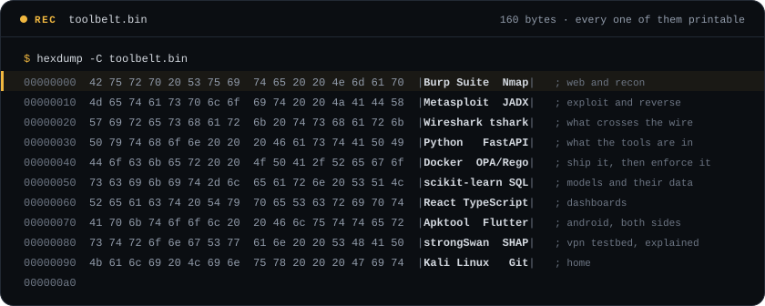

 



<a href="https://prathameshtikle.tech">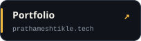</a>
<a href="https://www.linkedin.com/in/prathamesh-tikle">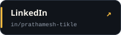</a>
<a href="https://tryhackme.com/p/77Pseudo">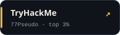</a>

 


<picture>
  <source media="(prefers-color-scheme: dark)" srcset="https://raw.githubusercontent.com/Prathamesh0-0/Prathamesh0-0/output/snake-dark.svg">
  
</picture>

Every image above is hand-written SVG and CSS, generated by <a href="scripts/build.py">scripts/build.py</a>. No trackers and no third-party widgets.

